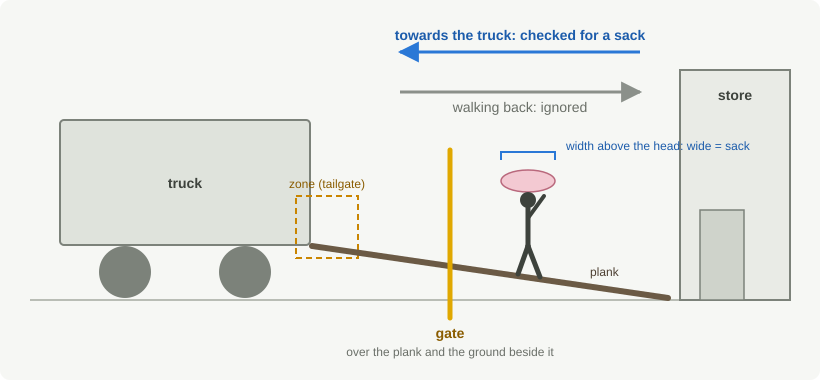
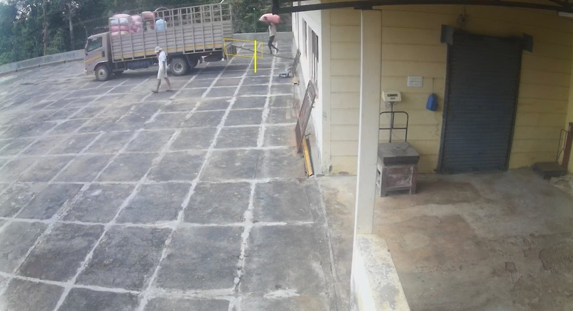
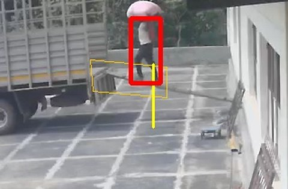
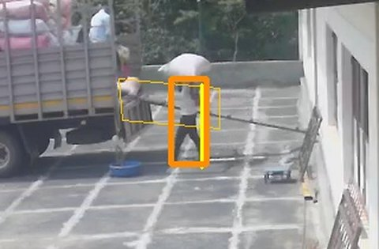
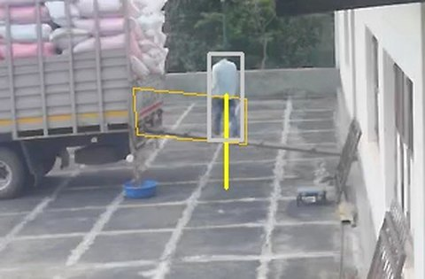

# CCTV Bag Counter

Counts sacks carried onto a truck from fixed-camera CCTV footage, and marks each
count as **sure** or **unclear** so that only the unclear ones need a person to
look at a snapshot.

It was built for a warehouse loading bay where the manual tally and the footage
needed to agree. It needs no training data: it combines a stock person detector
with a simple geometric rule and a per-camera settings file.

## Result so far

Checked on one 85-minute clip in which 200 bags were loaded (ground truth
established frame by frame):

| | Counted | Correct | Not a bag | Bags missed |
|---|---|---|---|---|
| First rule: anyone stepping onto the top of the plank | 223 | 195 | 28 | 5 |
| Current rule: gate crossing + sack check | 201 | 200 | 1 | 0 |

Of the 201, 192 were marked sure (all correct) and 9 unclear (8 correct). The
single wrong count is among the unclear ones.

The thresholds were tuned on this one clip with the answer known. Treat the
accuracy as unproven on other footage until a second clip has been checked.

## How it counts



1. **Track people.** Every person is detected and tracked with
   [Ultralytics YOLO11](https://docs.ultralytics.com/) and ByteTrack. Positions
   are written to `tracks.csv`. This is the slow part and wants a GPU.
2. **Watch a gate.** A line is drawn across the path to the truck, over the
   loading plank and the ground beside it. Only feet crossing it *towards* the
   truck are considered, so carriers walking back and the stacker standing on
   the truck are never counted.
3. **Check for a sack.** At each crossing, the frame is compared with the empty
   background a few seconds before and after, and the width of the shape above
   the person's head is measured. A sack is much wider than a head or a hat.

| Crossing | Result |
|---|---|
| Wide shape, came up the plank | **bag** |
| Borderline shape, or came along the ground beside the plank | **unclear**: counted and flagged |
| Narrow shape | not counted; logged in `no_bag.csv` for auditing |

### What it looks like

The camera view with the tailgate zone and the gate line drawn in yellow:



Annotated frames written by the counter, one per crossing:

| Bag | Unclear | No bag |
|---|---|---|
|  |  |  |
| Sack on the head, came up the plank. Counted. | Has a sack but walked along the ground beside the plank. Counted and flagged. | Crossed towards the truck with nothing on the head. Not counted. |

## Quick start

```bash
pip install -r requirements.txt
```

**1. Describe the camera view** (once per camera angle):

```bash
python bag_counter.py setup --video clip.mp4 --zone camera.json \
    --points "500,110 585,118 585,152 503,145" --gate "570,115 570,185"
```

- `--points`: corners of a zone around the truck's tailgate. Leave it out to click them in a window.
- `--gate`: two points forming a line across the path to the truck. Start at the plank end and finish on the ground beside it.
- `--plank-part`: share of the gate, from its first point, that lies over the plank (default 0.62).

Check the `camera_preview.jpg` it writes. `main_godown_zone.json` is a working example.

**2. Count:**

```bash
python bag_counter.py run --video clip.mp4 --zone camera.json
```

**3. Re-count without the GPU** after moving the gate or changing a threshold.
This reuses `tracks.csv` and takes about a minute:

```bash
python bag_counter.py recount --video clip.mp4 --zone camera.json
```

## Output

Written to `<video name>_results/`:

| File | Contents |
|---|---|
| `summary.txt` | Total, how many are sure, and the list of unclear counts |
| `events.csv` | One row per counted bag: video time, clock time, status (`bag` / `unclear`), path (`plank` / `ground`), measured width |
| `snapshots/` | One annotated frame per counted bag; unclear ones end in `_UNCLEAR.jpg` |
| `no_bag.csv`, `no_bag/` | People who crossed towards the truck without a sack |
| `tracks.csv` | Every tracked person on every analysed frame |

## Options

| Option | Purpose |
|---|---|
| `--start 600 --end 900` | Test on a five-minute slice first |
| `--file-clock` | Fill clock times from an NVR-style file name such as `Camera_2026-01-15_09-30-00.mp4` |
| `--start-clock "2026-01-15 09:30:00"` | Set the clock explicitly; file names can be a few seconds off the on-screen clock |
| `--save-video` | Also write a video with every tracked person boxed |
| `--min-gap 8` | Seconds before the same tracked person can count again |
| `--model yolo11n.pt` / `yolo11m.pt` | Faster / more accurate detector |
| `--imgsz 960 --sample-fps 4` | Roughly halves CPU time, at some risk to small, distant people |

The camera file also holds `bag_width_sure` and `bag_width_min`, the two
thresholds (in pixels at the file's `frame_size`) for the sack check.

## Running on a GPU

Tracking 1.5 hours of 720p video takes about 10 minutes on an NVIDIA L4,
15 minutes on a T4, and two to three hours on a four-core CPU.

- `bag_counter_gpu.ipynb` runs the whole thing in JupyterLab (for example a
  Vertex AI Workbench instance with a GPU): put videos in `videos/` or set
  `BUCKET` to a Cloud Storage folder, then run all cells.
- `scripts/gpu_vm_startup.sh` does the same unattended as the startup script of
  a Compute Engine Deep Learning VM, then powers the machine off.

Stop and delete GPU machines when finished; a stopped instance still bills for
its disks.

## Limitations

- Tuned and checked on a single clip from a single camera.
- The gate is specific to where the truck and plank are. If the truck parks
  elsewhere, redo `setup`.
- The sack check assumes sacks are carried on the head or shoulder and that the
  camera is fixed.
- People standing in front of the plank can hide a carrier.
- Always review the unclear snapshots before relying on a total.

## Footage and privacy

Apart from the four example frames above, which are cropped and have the
on-screen date removed, no footage, snapshots or results are included in this
repository, and `.gitignore` keeps them out. CCTV recordings show identifiable
people; handle them under your own site's rules.

## Dependencies

Python 3.10+, `ultralytics`, `lap`, `opencv-python` (see `requirements.txt`).
H.265 recordings may need converting first:

```bash
ffmpeg -i input.mp4 -c:v libx264 -crf 23 -preset veryfast converted.mp4
```

See `model/MODEL_INFO.md` for the detector and settings used.

## License

AGPL-3.0, see [LICENSE](LICENSE). This matches the Ultralytics YOLO dependency,
which is also AGPL-3.0; review those terms before using this in a commercial
product.
